# Vaccination Timeliness

[🌐 Lea esto en
español](https://im-data-paho.github.io/pahoabc/articles/es/vaccination_timeliness_es.md)

## Rationale

A country’s immunization schedule is established taking into account the
characteristics of each vaccine, the natural history of the disease it
aims to prevent, the characteristics of the person who will receive it,
the population’s access to vaccination sites, and their willingness to
get vaccinated (or to have their children vaccinated).

Vaccination aims to reduce the greatest possible burden of disease by
acting ahead of the period of life in which the risk of severe illness
and death from that disease is highest. At the same time, the schedule
must consider the vaccine’s capacity to generate immunity and the
duration of that immunity, which is conditioned (especially during the
first year of life) by the maturity of the immune system. These factors
determine, for example, the need for more than one dose, booster doses
throughout the life course, the compatibility of vaccines administered
simultaneously, and the minimum intervals between doses.

To obtain the greatest benefit from the schedule established by the
health authorities, compliance by the population is essential, not only
by completing the schedule, but by doing so in a **timely** manner.
Knowing vaccination timeliness, that is, how closely vaccines are
administered according to the schedule, allows us to:

- understand coverage and its impact on the epidemiology of the disease,
- monitor the supply chain of vaccines and supplies,
- investigate access problems or willingness to vaccinate in certain
  communities, and
- through actions at different levels, prevent future dropouts.

Therefore, **the objective of this indicator** is to analyze vaccination
timeliness in the population, that is, the time that elapses between the
age of eligibility for a given vaccine dose and the occurrence of the
vaccination, using nominal data from Electronic Immunization Registries
(EIR).

> **Note**
>
> 1.  All functions used for vaccination timeliness analyses within
>     PAHOabc begin with the `vt_` prefix.

### Non-probabilistic Analysis

The non-probabilistic analysis measures the time that elapses between
the age indicated for a given dose and its administration. It is based
on the database of vaccinated individuals in the EIR, so it is measured
retrospectively over the total number of individuals who received the
dose. It estimates the proportion of individuals who receive the vaccine
in a timely manner and the proportion who receive it in an untimely
manner. Those who did not receive the vaccine in a timely manner are
then stratified according to the time elapsed outside the timeliness
window.

#### Operational Definitions

- **Timely vaccination**: vaccination administered within the time range
  defined by the country as the timeliness standard for each dose of a
  vaccine.
- **Percentage of timely vaccination**: proportion of the population
  that received a dose within its timeliness window, out of the total
  population that received that dose.
- **Distribution by time elapsed (delay)**: stratification of the
  individuals who did not receive the dose in a timely manner,
  distributed into time categories defined by the country.

#### Required Definitions

Before carrying out the analysis, the country must define:

- **Vaccines to evaluate**: each vaccine dose is analyzed individually.
  An aggregated analysis of several doses can then be carried out.
- **Timeliness per vaccine**: for each dose, the period considered
  timely is defined, with a minimum and a maximum age, according to the
  country’s guidelines. In PAHOabc, this period corresponds to the
  `age_schedule_low` and `age_schedule_high` columns of the vaccination
  schedule.
- **Time categories**: ranges of days used to distribute untimely
  vaccinations. The country defines the ranges, although the package
  includes predefined ranges.
- **Year to evaluate**: it is up to the country to analyze by birth
  cohort or by calendar year. The `vt_` functions allow filtering by
  birth cohort with the `birth_cohorts` parameter.
- **Level of geographic disaggregation**: national (ADM0), first
  subnational level (ADM1), or second subnational level (ADM2).
- **Minimum observation period**: each individual included in the
  analysis must have at least completed the timeliness window of the
  dose being evaluated.

> **Warning**
>
> PAHOabc does not verify the minimum observation period. If birth
> cohorts that have not yet completed the timeliness window by the date
> the data were extracted are included, only those already vaccinated
> will appear in the EIR, which overestimates timeliness. Choose
> `birth_cohorts` that have had enough time to complete the timeliness
> window of the doses analyzed.

#### Characteristics of the Analysis

- It is a cross-sectional analysis: the number of days between the date
  of birth and the date of administration of the dose is measured and
  compared with the timeliness standard defined by the country. If the
  age at vaccination falls within the timeliness window, the dose is
  classified as timely; if it falls before or after it, it is classified
  as untimely.
- It is independent of the size of the target population: the
  denominator is all individuals who received the dose being evaluated.
- It requires the vaccination schedule with the specification of the
  timeliness standard.
- It uses the place of **residence** for subnational analyses.

#### Calculation of the Indicator

The timely vaccination indicator is calculated as:

``` math
\text{Timely vaccination (\%)} = \frac{\text{Doses of vaccine X administered in a timely manner}}{\text{Total doses of vaccine X administered in a given period and place}} \times 100
```

The distribution of untimely doses by time range is calculated as:

``` math
\text{Untimely doses in range A (\%)} = \frac{\text{Untimely doses in range A}}{\text{Total untimely doses in a given period and place}} \times 100
```

### Probabilistic Analysis

The probabilistic analysis estimates the **cumulative incidence** of the
event “administration of a vaccine dose”, that is, the probability that
a given population receives the dose as time goes by (from the moment it
becomes eligible to receive it). From this curve, the probability of
being vaccinated in a timely manner and the time needed to vaccinate
different percentiles of the population are estimated.

> **Note**
>
> Ideally, this analysis considers the entire population that should
> receive the vaccine (for example, from the live birth registry).
> PAHOabc works with the database of vaccinated individuals in the EIR,
> that is, only with the individuals who received the dose analyzed. In
> this case, the final probability will always be 100%, which
> **overestimates** the real probability of vaccination of the
> population.

#### Operational Definitions

- **Timely vaccination**: as in the non-probabilistic analysis,
  vaccination administered within the timeliness window defined by the
  country for each dose. In this analysis, **day 0** (start of the
  observation period) corresponds to the lower limit of the timeliness
  window (`age_schedule_low`), and doses administered before that day
  are not included.
- **Probability of being vaccinated by day t**: cumulative incidence of
  vaccination by day t. When t corresponds to the upper limit of the
  timeliness window, the probability of the population being vaccinated
  in a timely manner is obtained.
- **Time needed to vaccinate a percentage of the population**: number of
  days from the start of the timeliness window that it takes to
  vaccinate a given percentile of the population (for example, 25%, 50%
  and 75%).

#### Required Definitions

- **Vaccines to evaluate**: each dose is analyzed individually. PAHOabc
  also allows combining several doses into a single curve (aligned
  according to the day 0 of each one), but in that case it is not
  possible to show a single timeliness window, since each dose has its
  own.
- **Timeliness per vaccine**: same as in the non-probabilistic analysis
  (between `age_schedule_low` and `age_schedule_high`).
- **Population percentiles**: it is recommended to estimate at least the
  times for 25%, 50% and 75%.
- **Year to evaluate**: using a birth cohort is suggested. PAHOabc also
  allows combining several cohorts (see the warning below).
- **Level of geographic disaggregation**: ADM0, ADM1 or ADM2.

> **Warning**
>
> This analysis follows the vaccination curve well beyond the timeliness
> window, so the observation period needed is longer. If birth cohorts
> that have not completed that observation period by the date the data
> were extracted are included, only those vaccinated before that date
> will appear in the EIR. Those vaccinated afterwards do not appear yet,
> so the curve may show faster vaccination than is really the case. To
> mitigate this, choose birth cohorts that have completed the
> observation period, or exclude incomplete cohorts.

#### Characteristics of the Analysis

- It is a cumulative incidence analysis, which corresponds to the
  complement of the Kaplan-Meier survival function. Kaplan-Meier
  estimates the probability that an event does **not** happen over time;
  its complement gives the probability that it **does** happen, in this
  case, vaccination.
- Time is counted from the moment the individual becomes eligible for
  the dose (from `age_schedule_low`). All those vaccinated up to the
  upper limit of the timeliness window are considered timely.
- It is independent of the size of the population: the denominator is
  the total number of records included in the analysis.
- It requires the vaccination schedule with the definition of the
  timeliness window of each dose.
- It uses the place of **residence** for subnational analyses.

#### Calculation of the Indicator

The cumulative incidence of vaccination by day t is the complement of
the Kaplan-Meier survival function:

``` math
F(t) = 1 - S(t)
```

where $`F(t)`$ is the probability of having been vaccinated by day t and
$`S(t)`$ is the probability of not having been vaccinated by day t.
Since the EIR only contains vaccinated individuals (there is no
censoring), $`F(t)`$ is simply the cumulative percentage of records
vaccinated by day t:

``` math
F(t) \;(\%) = \frac{\text{Records vaccinated between day 0 and day t}}{\text{Total records vaccinated from day 0 onwards}} \times 100
```

> **Note**
>
> Records vaccinated before the timeliness window (before day 0) and
> those with a missing date are excluded from both the numerator and the
> denominator, and are reported separately. Therefore, $`F(t)`$
> evaluated on the last day of the timeliness window is **not equal** to
> the `TIMELY` percentage of
> [`vt_rate()`](https://im-data-paho.github.io/pahoabc/reference/vt_rate.md),
> which does include those vaccinated before the window in its
> denominator.

## Glossary

### Political Geographic Boundaries

Throughout this vignette, we will make reference to different levels of
political geographic boundaries. These levels are defined by the
country/territory and can have different names from country to country.
PAHOabc is agnostic to these names and requires the user to recode their
variable names to fit the PAHOabc structure.

Namely, PAHOabc can distinguish three administrative levels, which
listed from top to bottom level are: ADM0, ADM1 and ADM2.

1.  ADM0: The country. This is the top-most administrative level.
2.  ADM1: The first geographic subdivision in the country. ADM0 contains
    several ADM1 subdivisions.
3.  ADM2: The second geographic subdivision in the country. Each ADM1
    contains several ADM2 subdivisions.

### Timeliness Categories

| Category | Meaning |
|----|----|
| `TIMELY` | The age at vaccination falls within `[age_schedule_low, age_schedule_high]`. |
| `UNTIMELY` | The age at vaccination falls outside `[age_schedule_low, age_schedule_high]`, either before or after the timeliness window. |
| `DATE_MISSING` | `date_vax` or `date_birth` is `NA`. |

## Usage

### Install Package

``` r

devtools::install_github("IM-Data-PAHO/pahoabc")
```

### Load Data

The functions in this module require your **EIR dataset** and a
**vaccination schedule** with the timeliness windows, both in the
standard PAHOabc format.

#### EIR

The
[`pahoabc::pahoabc.EIR`](https://im-data-paho.github.io/pahoabc/reference/pahoabc.EIR.md)
data frame provides a simulated, nominal-level table representing
individual vaccination events from an EIR. Each row corresponds to a
single vaccination act for a person.

``` r

pahoabc.EIR %>% head() %>% kable(caption = "Example Electronic Immunization Registry")
```

| ID | date_birth | date_vax | ADM1_residence | ADM2_residence | ADM1_occurrence | ADM2_occurrence | dose |
|---:|:---|:---|:---|:---|:---|:---|:---|
| 191997 | 2023-08-08 | 2023-12-26 | ADM1_4 | ADM2_4_35 | ADM1_4 | ADM2_4_35 | DTP2 |
| 212189 | 2023-12-20 | 2023-12-26 | ADM1_5 | ADM2_5_61 | ADM1_5 | ADM2_5_61 | BCG RN |
| 118063 | 2022-09-15 | 2023-12-26 | ADM1_2 | ADM2_2_5 | ADM1_2 | ADM2_2_5 | DTP1 |
| 118063 | 2022-09-15 | 2023-12-26 | ADM1_2 | ADM2_2_5 | ADM1_2 | ADM2_2_5 | YFV1 |
| 130751 | 2022-10-27 | 2023-12-12 | ADM1_5 | ADM2_5_55 | ADM1_5 | ADM2_5_55 | YFV1 |
| 136532 | 2021-09-21 | 2023-12-26 | ADM1_3 | ADM2_3_12 | ADM1_3 | ADM2_3_12 | SRP1 |

Example Electronic Immunization Registry {.table style="width:100%;"}

- `ID`: Unique person identification number.
- `date_birth`: Date of birth of person.
- `date_vax`: Date of vaccination event.
- `ADM1_residence` / `ADM2_residence`: First and second geographic
  administrative levels of residence.
- `dose`: Combined variable representing vaccine type and dose number
  (e.g., DTP1).

> **Warning**
>
> 1.  The functions in this module calculate age at vaccination as
>     `date_vax - date_birth`. If `data.EIR` contains records where
>     `date_vax` occurs before `date_birth` (i.e., a negative age at
>     vaccination), this points to a **date consistency** error. When
>     this happens, `vt_` functions will emit a warning directing you to
>     the [Date Consistency Comparison
>     module](https://im-data-paho.github.io/pahoabc/articles/en/date_consistency_comparison_en.md)
>     to identify and resolve those records first.
> 2.  The functions in this module count vaccination records, not
>     individuals. If `data.EIR` contains duplicate records (the same
>     `ID` and `dose` registered more than once), that individual is
>     counted more than once in both the numerator and the denominator.
>     PAHOabc does not remove duplicates, so make sure to remove them
>     before running the analysis. Note that it is up to you to decide
>     which record to keep for each `ID` and `dose` (e.g., the one with
>     the earliest `date_vax`).

#### Vaccination Schedule

The
[`pahoabc::pahoabc.schedule`](https://im-data-paho.github.io/pahoabc/reference/pahoabc.schedule.md)
dataset defines the national immunization schedule, listing for each
vaccine dose its age of administration and its timeliness window, in
days.

``` r

pahoabc.schedule %>% kable(caption = "Example Immunization Schedule with timeliness windows")
```

| dose   | age_schedule | age_schedule_low | age_schedule_high |
|:-------|-------------:|-----------------:|------------------:|
| SRP1   |          365 |              360 |               420 |
| DTP1   |           60 |               54 |                90 |
| DTP2   |          120 |              116 |               150 |
| DTP3   |          180 |              176 |               210 |
| BCG RN |            0 |                0 |                28 |
| YFV1   |          365 |              360 |               420 |

Example Immunization Schedule with timeliness windows {.table}

- `dose`: Combined variable representing vaccine type and dose number.
- `age_schedule`: The age of administration of the corresponding `dose`,
  in days.
- `age_schedule_low`: The minimum age of the timeliness window, in days.
- `age_schedule_high`: The maximum age of the timeliness window, in
  days.

For example, in this schedule DTP1 is indicated at 60 days of age and is
considered timely if administered between 54 and 90 days of age.

### Non-probabilistic Analysis

#### Expected Workflow

The functions for the non-probabilistic analysis are:

1.  [`vt_rate()`](https://im-data-paho.github.io/pahoabc/reference/vt_rate.md):
    computes the percentage of timely vaccination, pooled across several
    doses or disaggregated by dose, and by geographic level.
2.  [`vt_barplot()`](https://im-data-paho.github.io/pahoabc/reference/vt_barplot.md):
    visualizes the output of
    [`vt_rate()`](https://im-data-paho.github.io/pahoabc/reference/vt_rate.md)
    as a stacked bar chart.
3.  [`vt_inconsistent()`](https://im-data-paho.github.io/pahoabc/reference/vt_inconsistent.md):
    lists individual untimely and missing-date records, also indicating
    the number of days outside the timeliness window.
4.  [`vt_inconsistent_plot()`](https://im-data-paho.github.io/pahoabc/reference/vt_inconsistent_plot.md):
    visualizes the distribution of untimely doses by the number of days
    outside the timeliness window.


Figure 1. Expected workflow for the non-probabilistic section of the
vaccination timeliness analysis.

  

> **Note**
>
> 1.  The examples below analyze the 2022 birth cohort. The example data
>     includes vaccinations up to December 31, 2023, so this cohort has
>     completed the timeliness window of the doses administered during
>     the first year of life.
> 2.  Filtering by `birth_cohorts` excludes records with no date of
>     birth, so in that case `DATE_MISSING` only counts records missing
>     the date of vaccination.

#### Step 1 — Compute the indicator with `vt_rate()`

[`vt_rate()`](https://im-data-paho.github.io/pahoabc/reference/vt_rate.md)
compares the age at vaccination against the timeliness window of each
dose and returns the number (`n`) and percentage (`rate`) of records
that are `TIMELY`, `UNTIMELY`, or `DATE_MISSING`, out of the total
number of records (`total`).

By default, `vaccines = NULL` pools all doses in `data.schedule` into a
single indicator. Here we compute the pooled indicator at the ADM1
level:

``` r

rate_df <- vt_rate(
  data.EIR      = pahoabc.EIR,
  data.schedule = pahoabc.schedule,
  geo_level     = "ADM1",
  birth_cohorts = 2022
)

rate_df %>% kable(digits = 2, caption = "Vaccination timeliness pooled by ADM1, 2022 cohort")
```

| ADM1   | timeliness |      n |  total |  rate |
|:-------|:-----------|-------:|-------:|------:|
| ADM1_1 | TIMELY     |   3710 |   6167 | 60.16 |
| ADM1_1 | UNTIMELY   |   2457 |   6167 | 39.84 |
| ADM1_2 | TIMELY     |  23955 |  32632 | 73.41 |
| ADM1_2 | UNTIMELY   |   8677 |  32632 | 26.59 |
| ADM1_3 | TIMELY     | 103604 | 144709 | 71.59 |
| ADM1_3 | UNTIMELY   |  41105 | 144709 | 28.41 |
| ADM1_4 | TIMELY     |  18769 |  21712 | 86.45 |
| ADM1_4 | UNTIMELY   |   2943 |  21712 | 13.55 |
| ADM1_5 | TIMELY     |   9014 |  11323 | 79.61 |
| ADM1_5 | UNTIMELY   |   2309 |  11323 | 20.39 |

Vaccination timeliness pooled by ADM1, 2022 cohort {.table}

Specifying `vaccines` disaggregates the results by `dose`:

``` r

rate_by_dose_df <- vt_rate(
  data.EIR      = pahoabc.EIR,
  data.schedule = pahoabc.schedule,
  geo_level     = "ADM1",
  vaccines      = c("DTP1", "DTP2", "DTP3"),
  birth_cohorts = 2022
)

rate_by_dose_df %>% head(10) %>% kable(digits = 2, caption = "Vaccination timeliness by dose and ADM1, 2022 cohort")
```

| dose | ADM1   | timeliness |     n | total |  rate |
|:-----|:-------|:-----------|------:|------:|------:|
| DTP1 | ADM1_1 | TIMELY     |   767 |  1187 | 64.62 |
| DTP1 | ADM1_1 | UNTIMELY   |   420 |  1187 | 35.38 |
| DTP1 | ADM1_2 | TIMELY     |  4963 |  6065 | 81.83 |
| DTP1 | ADM1_2 | UNTIMELY   |  1102 |  6065 | 18.17 |
| DTP1 | ADM1_3 | TIMELY     | 22380 | 27587 | 81.13 |
| DTP1 | ADM1_3 | UNTIMELY   |  5207 | 27587 | 18.87 |
| DTP1 | ADM1_4 | TIMELY     |  3418 |  3818 | 89.52 |
| DTP1 | ADM1_4 | UNTIMELY   |   400 |  3818 | 10.48 |
| DTP1 | ADM1_5 | TIMELY     |  1712 |  2004 | 85.43 |
| DTP1 | ADM1_5 | UNTIMELY   |   292 |  2004 | 14.57 |

Vaccination timeliness by dose and ADM1, 2022 cohort {.table}

##### Parameters accepted

- `data.EIR`: EIR data frame in PAHOabc format.
- `data.schedule`: Vaccination schedule data frame in PAHOabc format.
- `geo_level`: `"ADM0"` (default), `"ADM1"`, or `"ADM2"`.
- `vaccines`: Character vector of doses to include, disaggregating
  results by `dose`. Default `NULL` pools all doses in `data.schedule`.
- `birth_cohorts`: Numeric vector of birth cohort year(s) to include.
  Default `NULL` uses all available cohorts.

#### Step 2 — Visualize the indicator with `vt_barplot()`

The output of
[`vt_rate()`](https://im-data-paho.github.io/pahoabc/reference/vt_rate.md)
can be passed directly to
[`vt_barplot()`](https://im-data-paho.github.io/pahoabc/reference/vt_barplot.md)
to produce a stacked bar chart. If the data is disaggregated by `dose`,
the plot is automatically faceted by dose.

``` r

vt_barplot(data = rate_df)
```

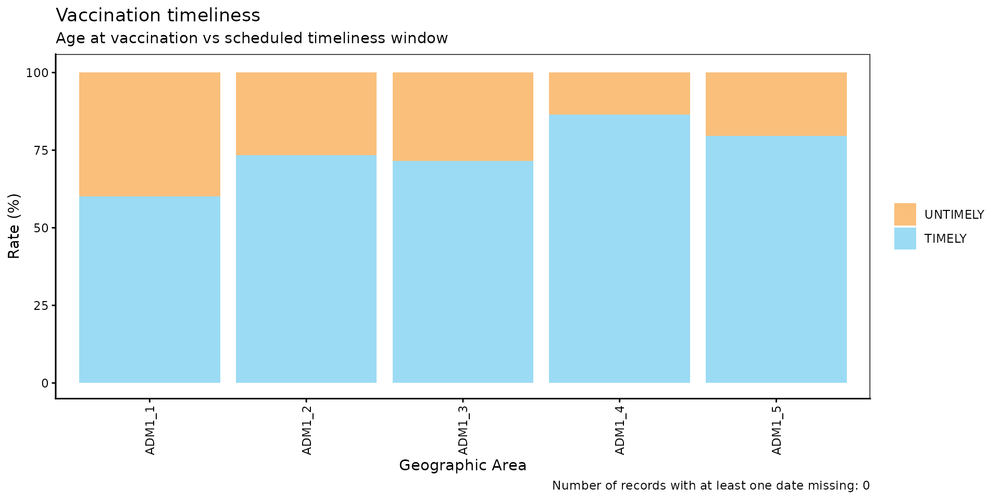

``` r

vt_barplot(data = rate_by_dose_df)
```

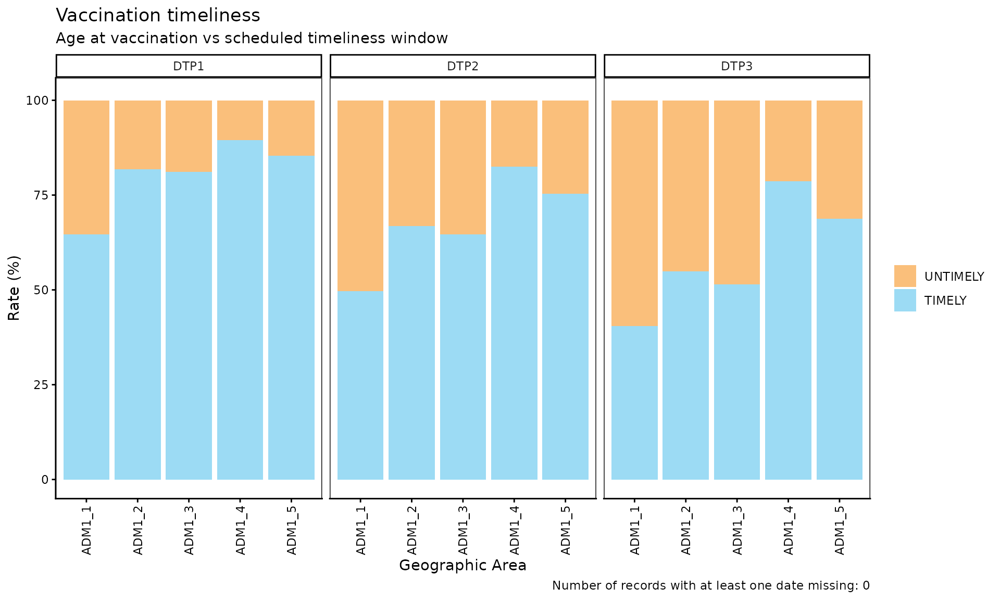

##### Parameters accepted

- `data`: Output of
  [`vt_rate()`](https://im-data-paho.github.io/pahoabc/reference/vt_rate.md).
- `within_ADM1`: Character vector to filter to specific ADM1 units when
  `geo_level = "ADM2"`. Default: `NULL`.
- `plot_missing`: Boolean. If `TRUE` (default), `DATE_MISSING` records
  are shown as a separate bar segment so all bars sum to 100%.

##### Interpretation

Each bar represents a geographic unit and is divided into segments:
`TIMELY` (blue), `UNTIMELY` (orange), and `DATE_MISSING` (grey). Bars
with a larger orange share indicate units where a large share of doses
are administered outside the timeliness window, a signal worth
investigating for possible access, willingness to vaccinate, or supply
issues in those units.

> **Note**
>
> No grey segment appears because filtering by the 2022 cohort excluded
> records with no date of birth, and no records in this cohort are
> missing the date of vaccination.

#### Step 3 — Inspect individual untimely records with `vt_inconsistent()`

[`vt_inconsistent()`](https://im-data-paho.github.io/pahoabc/reference/vt_inconsistent.md)
returns a record-level table of all `UNTIMELY` and `DATE_MISSING` doses,
including the number of days outside the timeliness window.

> **Note**
>
> In this example we do not filter by birth cohort, because doing so
> would exclude records with no date of birth.

``` r

inconsistent_df <- vt_inconsistent(
  data.EIR      = pahoabc.EIR,
  data.schedule = pahoabc.schedule,
  vaccines      = "DTP1"
)

inconsistent_df %>%
  # shows up to 3 UNTIMELY and up to 3 DATE_MISSING records
  group_by(timeliness) %>%
  slice_head(n = 3) %>%
  ungroup() %>%
  kable(caption = "Sample of untimely and missing-date DTP1 records")
```

| ID | dose | date_birth | date_vax | age_at_vax | age_schedule_low | age_schedule_high | days_outside_range | timeliness |
|---:|:---|:---|:---|---:|---:|---:|---:|:---|
| 71494 | DTP1 | NA | 2022-04-11 | NA | 54 | 90 | NA | DATE_MISSING |
| 86449 | DTP1 | NA | 2022-06-08 | NA | 54 | 90 | NA | DATE_MISSING |
| 118063 | DTP1 | 2022-09-15 | 2023-12-26 | 467 | 54 | 90 | 377 | UNTIMELY |
| 187807 | DTP1 | 2023-07-19 | 2023-12-26 | 160 | 54 | 90 | 70 | UNTIMELY |
| 212197 | DTP1 | 2022-10-23 | 2023-12-19 | 422 | 54 | 90 | 332 | UNTIMELY |

Sample of untimely and missing-date DTP1 records {.table}

##### Parameters accepted

- `data.EIR`: EIR data frame in PAHOabc format.
- `data.schedule`: Vaccination schedule data frame in PAHOabc format.
- `vaccines`: Character vector of doses to include. Default `NULL`
  includes all doses in `data.schedule`.
- `birth_cohorts`: Numeric vector of birth cohort year(s) to include.
  Default `NULL` uses all available cohorts.

The `days_outside_range` column is negative when a person was vaccinated
before `age_schedule_low`, and positive when vaccinated after
`age_schedule_high` (`NA` when a date is missing). This table can be
exported for record-level follow-up.

#### Step 4 — Visualize the distribution by time elapsed with `vt_inconsistent_plot()`

[`vt_inconsistent_plot()`](https://im-data-paho.github.io/pahoabc/reference/vt_inconsistent_plot.md)
produces a plot of untimely doses, grouped by the number of days outside
the timeliness window. Doses administered after the timeliness window
and before it are shown in separate rows, each with its own y-axis
scale.

``` r

vt_inconsistent_plot(
  data.EIR      = pahoabc.EIR,
  data.schedule = pahoabc.schedule,
  vaccines      = "DTP1",
  birth_cohorts = 2022
)
```

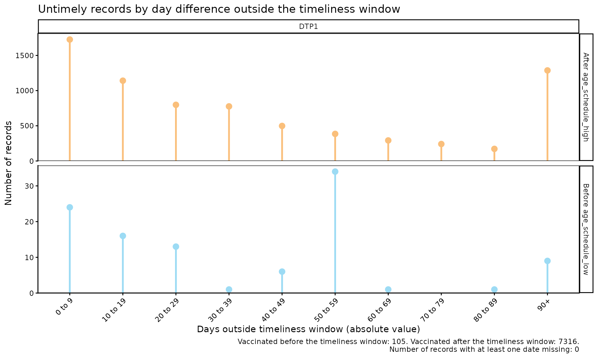

When more than one vaccine is specified, the plot adds one column per
dose. Within each row, all doses share the same scale, so they can be
compared with each other:

``` r

vt_inconsistent_plot(
  data.EIR      = pahoabc.EIR,
  data.schedule = pahoabc.schedule,
  vaccines      = c("DTP1", "DTP2", "DTP3"),
  birth_cohorts = 2022
)
```

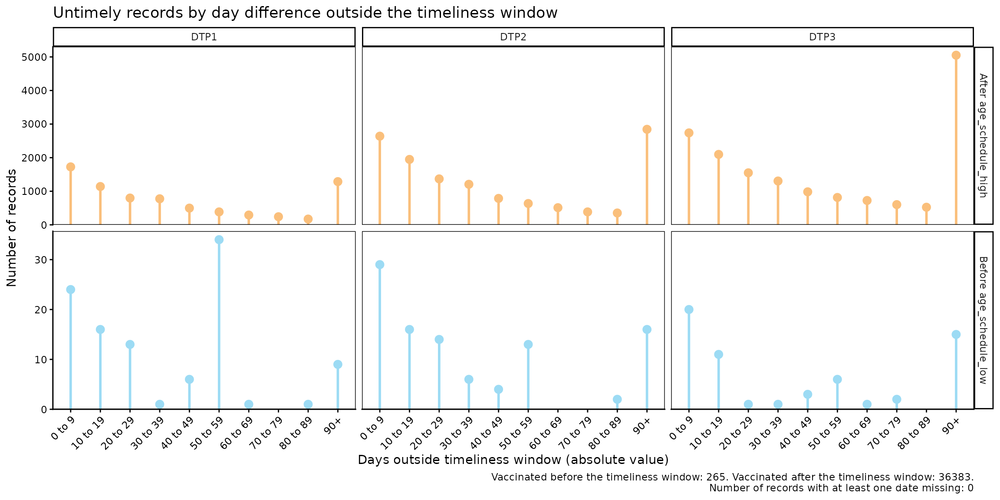

##### Parameters accepted

- `data.EIR`: EIR data frame in PAHOabc format.
- `data.schedule`: Vaccination schedule data frame in PAHOabc format.
- `vaccines`: Character vector of doses to include, adding one column
  per `dose`. Default `NULL` pools the results of all doses into a
  single column.
- `birth_cohorts`: Numeric vector of birth cohort year(s) to include.
  Default `NULL` uses all available cohorts.
- `day_groups`: Defines the categories on the horizontal axis. It is a
  list of `c(lower, upper)` numeric pairs defining the lower and upper
  limits of each category, in days. Categories must start at 0 and be
  contiguous (each one starts where the previous one ends). The last
  category always extends to the maximum value in the data and is
  labelled `"X+"`. Default: 10-day groups from 0 up to 90+ days.

Time categories are defined by each country. For example, to use the
categories 0 to 39 days, 40 to 49 days, 50 to 59 days, 60 to 89 days,
and 90 days or more:

``` r

vt_inconsistent_plot(
  data.EIR      = pahoabc.EIR,
  data.schedule = pahoabc.schedule,
  vaccines      = c("DTP1", "DTP2", "DTP3"),
  birth_cohorts = 2022,
  day_groups    = list(c(0, 40), c(40, 50), c(50, 60), c(60, 90), c(90, 120))
)
```

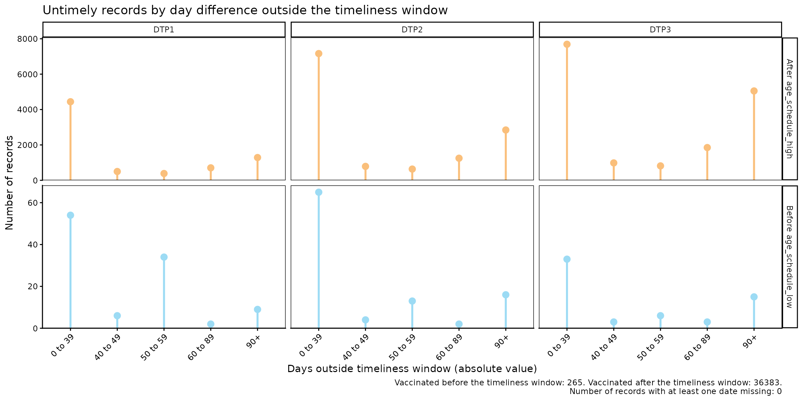

##### Interpretation

The top row represents doses administered after the timeliness window
(delay), while the bottom row shows doses administered before the
minimum age. Since each row has its own scale, only compare columns
within the same row, and use the summary in the plot caption to compare
between rows. The distribution of the data will let you assess where
delays are concentrated, for example: are the delays only a few days
long, or are most of them concentrated in delays of several months?
Likewise, doses administered before the minimum age can point to data
entry errors or problems in how the schedule is applied.

### Probabilistic Analysis

#### Expected Workflow

The functions for the probabilistic analysis are:

1.  [`vt_distribution()`](https://im-data-paho.github.io/pahoabc/reference/vt_distribution.md):
    computes, for each day since the start of the timeliness window, the
    percentage of records vaccinated on that day and the cumulative
    percentage (cumulative incidence). It allows disaggregating by dose
    and geographic level.
2.  [`vt_cdf_plot()`](https://im-data-paho.github.io/pahoabc/reference/vt_cdf_plot.md)
    and
    [`vt_pdf_plot()`](https://im-data-paho.github.io/pahoabc/reference/vt_pdf_plot.md):
    visualize the output of
    [`vt_distribution()`](https://im-data-paho.github.io/pahoabc/reference/vt_distribution.md)
    as a cumulative incidence curve (similar to a Kaplan-Meier curve) or
    as a curve of the percentage vaccinated per day, respectively.
3.  [`vt_percentile()`](https://im-data-paho.github.io/pahoabc/reference/vt_percentile.md):
    from the output of
    [`vt_distribution()`](https://im-data-paho.github.io/pahoabc/reference/vt_distribution.md),
    computes the number of days needed to vaccinate different
    percentiles of the population.
4.  [`vt_percentile_plot()`](https://im-data-paho.github.io/pahoabc/reference/vt_percentile_plot.md):
    generates visualizations from the output of
    [`vt_percentile()`](https://im-data-paho.github.io/pahoabc/reference/vt_percentile.md).


Figure 2. Expected workflow for the probabilistic section of the
vaccination timeliness analysis.

  

> **Note**
>
> As in the non-probabilistic analysis, the examples below analyze the
> 2022 birth cohort. Since the example data only include vaccinations up
> to December 31, 2023, very late vaccinations of this cohort are not
> observed yet.

#### Step 1 — Compute the distribution with `vt_distribution()`

[`vt_distribution()`](https://im-data-paho.github.io/pahoabc/reference/vt_distribution.md)
computes the age at vaccination and expresses it as days since the start
of the timeliness window (where day 0 corresponds to
`age_schedule_low`). By default, `vaccines = NULL` sums all doses in
`data.schedule` into a single distribution:

``` r

dist_df <- vt_distribution(
  data.EIR      = pahoabc.EIR,
  data.schedule = pahoabc.schedule,
  birth_cohorts = 2022
)

dist_df %>% head(10) %>% kable(digits = 2, caption = "Distribution of vaccinations by day, all doses combined, 2022 cohort")
```

| day |     n |  pdf | cum_n |   cdf | n_at_risk |  total | n_early | n_missing | window_end |
|----:|------:|-----:|------:|------:|----------:|-------:|--------:|----------:|-----------:|
|   0 |  3977 | 1.84 |  3977 |  1.84 |    216042 | 216042 |     501 |         0 |         NA |
|   1 | 15893 | 7.36 | 19870 |  9.20 |    212065 | 216042 |     501 |         0 |         NA |
|   2 |  6315 | 2.92 | 26185 | 12.12 |    196172 | 216042 |     501 |         0 |         NA |
|   3 |  2473 | 1.14 | 28658 | 13.27 |    189857 | 216042 |     501 |         0 |         NA |
|   4 |  2455 | 1.14 | 31113 | 14.40 |    187384 | 216042 |     501 |         0 |         NA |
|   5 |  4185 | 1.94 | 35298 | 16.34 |    184929 | 216042 |     501 |         0 |         NA |
|   6 |  5221 | 2.42 | 40519 | 18.76 |    180744 | 216042 |     501 |         0 |         NA |
|   7 |  9053 | 4.19 | 49572 | 22.95 |    175523 | 216042 |     501 |         0 |         NA |
|   8 |  9097 | 4.21 | 58669 | 27.16 |    166470 | 216042 |     501 |         0 |         NA |
|   9 |  7941 | 3.68 | 66610 | 30.83 |    157373 | 216042 |     501 |         0 |         NA |

Distribution of vaccinations by day, all doses combined, 2022 cohort
{.table}

When `vaccines` is specified, results are disaggregated by dose, and
each dose includes the last day of its timeliness window in the
`window_end` column:

``` r

dist_by_dose_ADM1_df <- vt_distribution(
  data.EIR      = pahoabc.EIR,
  data.schedule = pahoabc.schedule,
  geo_level     = "ADM1",
  vaccines      = c("DTP1", "DTP2", "DTP3"),
  birth_cohorts = 2022
)

dist_by_dose_ADM1_df %>% head(10) %>% kable(digits = 2, caption = "Distribution of vaccinations by day, dose and ADM1, 2022 cohort")
```

| dose | ADM1   | day |   n |  pdf | cum_n |   cdf | n_at_risk | total | n_early | n_missing | window_end |
|:-----|:-------|----:|----:|-----:|------:|------:|----------:|------:|--------:|----------:|-----------:|
| DTP1 | ADM1_1 |   0 |   1 | 0.08 |     1 |  0.08 |      1182 |  1182 |       5 |         0 |         36 |
| DTP1 | ADM1_1 |   2 |   1 | 0.08 |     2 |  0.17 |      1181 |  1182 |       5 |         0 |         36 |
| DTP1 | ADM1_1 |   3 |   2 | 0.17 |     4 |  0.34 |      1180 |  1182 |       5 |         0 |         36 |
| DTP1 | ADM1_1 |   4 |   3 | 0.25 |     7 |  0.59 |      1178 |  1182 |       5 |         0 |         36 |
| DTP1 | ADM1_1 |   5 |  26 | 2.20 |    33 |  2.79 |      1175 |  1182 |       5 |         0 |         36 |
| DTP1 | ADM1_1 |   6 |  16 | 1.35 |    49 |  4.15 |      1149 |  1182 |       5 |         0 |         36 |
| DTP1 | ADM1_1 |   7 |  53 | 4.48 |   102 |  8.63 |      1133 |  1182 |       5 |         0 |         36 |
| DTP1 | ADM1_1 |   8 |  54 | 4.57 |   156 | 13.20 |      1080 |  1182 |       5 |         0 |         36 |
| DTP1 | ADM1_1 |   9 |  40 | 3.38 |   196 | 16.58 |      1026 |  1182 |       5 |         0 |         36 |
| DTP1 | ADM1_1 |  10 |  45 | 3.81 |   241 | 20.39 |       986 |  1182 |       5 |         0 |         36 |

Distribution of vaccinations by day, dose and ADM1, 2022 cohort {.table}

The table contains one row per day (as long as at least one vaccination
occurred), with the following columns:

- `day`: days since the start of the timeliness window (from
  `age_schedule_low`).
- `n` and `pdf`: number and percentage of records vaccinated on that
  day.
- `cum_n` and `cdf`: cumulative number and percentage of records
  vaccinated up to that day (cumulative incidence).
- `n_at_risk`: number of records not yet vaccinated at the start of that
  day (population “at risk”).
- `total`: denominator, that is, all records vaccinated from day 0
  onwards.
- `n_early`: records vaccinated before the timeliness window, excluded
  from the analysis.
- `n_missing`: records with a missing date, excluded from the analysis.
- `window_end`: last day of the timeliness window
  (`age_schedule_high - age_schedule_low`). It is `NA` when doses are
  combined.

##### Parameters accepted

- `data.EIR`: EIR table in PAHOabc format.
- `data.schedule`: Vaccination schedule table in PAHOabc format.
- `geo_level`: `"ADM0"` (default), `"ADM1"`, or `"ADM2"`.
- `vaccines`: Character vector with the doses to include.
- `birth_cohorts`: Numeric vector with the birth cohort(s) to include.
  The default `NULL` uses all available cohorts.

#### Step 2 — Visualize the distribution with `vt_cdf_plot()` and `vt_pdf_plot()`

The output of
[`vt_distribution()`](https://im-data-paho.github.io/pahoabc/reference/vt_distribution.md)
can be passed directly to
[`vt_cdf_plot()`](https://im-data-paho.github.io/pahoabc/reference/vt_cdf_plot.md),
which plots the cumulative incidence curve. The `percentile` parameter
adds a line and a label with the number of days needed to reach that
percentile:

``` r

vt_cdf_plot(data = dist_df, percentile = 50)
```

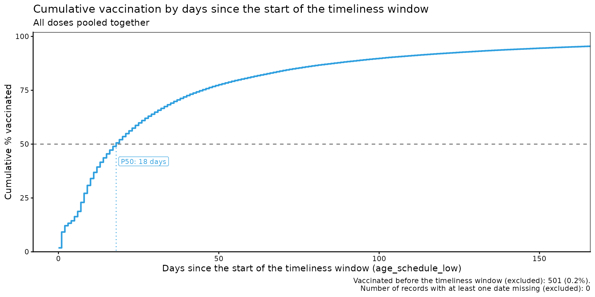

If the data is disaggregated by `dose`, the plot is organized in panels
by dose and the timeliness window of each one is shaded. If it is also
disaggregated geographically, each geographic area is shown as a thin
grey line, which serves as context, and all areas together are shown as
a single highlighted line. This way, the plot remains readable even with
tens or hundreds of geographic areas:

``` r

vt_cdf_plot(data = dist_by_dose_ADM1_df, percentile = 80)
```

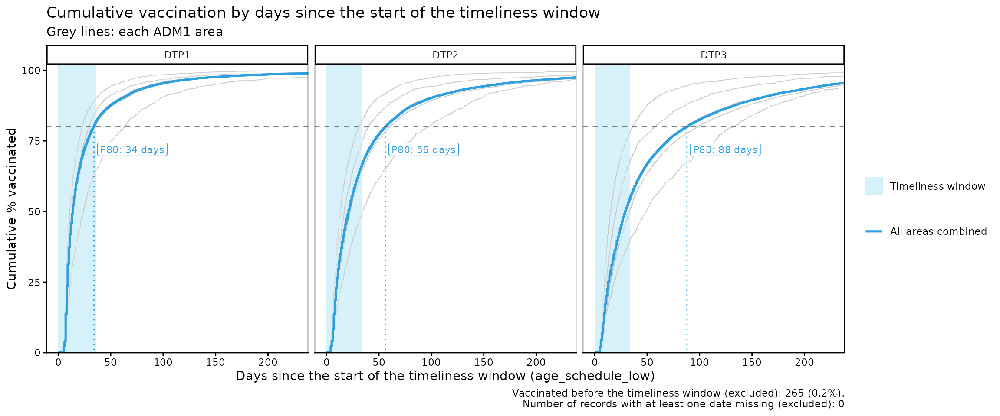

With the `highlight` parameter you can highlight up to 5 geographic
areas in color to compare them with all areas combined:

``` r

vt_cdf_plot(data = dist_by_dose_ADM1_df, percentile = 80, highlight = c("ADM1_1", "ADM1_4"))
```

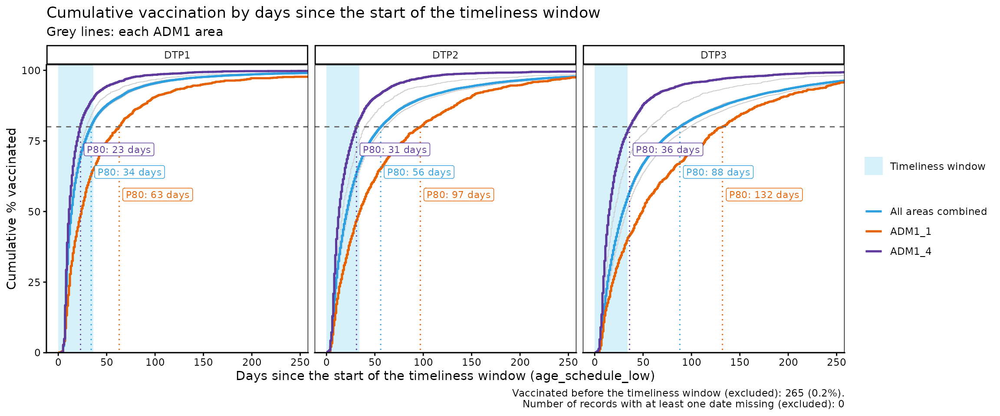

##### Parameters accepted by `vt_cdf_plot()`

- `data`: Output of
  [`vt_distribution()`](https://im-data-paho.github.io/pahoabc/reference/vt_distribution.md).
- `percentile`: A single percentile (greater than 0 and at most 100) to
  highlight in the plot, for all areas combined and for each area in
  `highlight`. Default: `NULL` (none).
- `highlight`: Character vector with up to 5 geographic areas (at the
  geographic level of `data`) to highlight in color. Only available if
  the data is disaggregated by ADM1 or ADM2. Default: `NULL` (none).
- `within_ADM1`: Character vector to filter specific ADM1 units when
  `geo_level = "ADM2"`. Default: `NULL`.
- `max_days`: Maximum number of days to show on the x-axis. The default
  `NULL` shows up to the day by which 95% of the records have been
  vaccinated (for all areas combined and for each highlighted area), so
  that a few very late vaccinations (or vaccinations with date errors)
  do not stretch the axis.

[`vt_pdf_plot()`](https://im-data-paho.github.io/pahoabc/reference/vt_pdf_plot.md)
plots the percentage of records vaccinated on each day (or in a group of
days, set by the `binwidth` parameter), which lets you see when
vaccinations are concentrated:

``` r

dist_by_dose_ADM0_df <- vt_distribution(
  data.EIR      = pahoabc.EIR,
  data.schedule = pahoabc.schedule,
  vaccines      = c("DTP1", "DTP2", "DTP3"),
  birth_cohorts = 2022
)

vt_pdf_plot(data = dist_by_dose_ADM0_df, percentile = 50, max_days = 150)
```

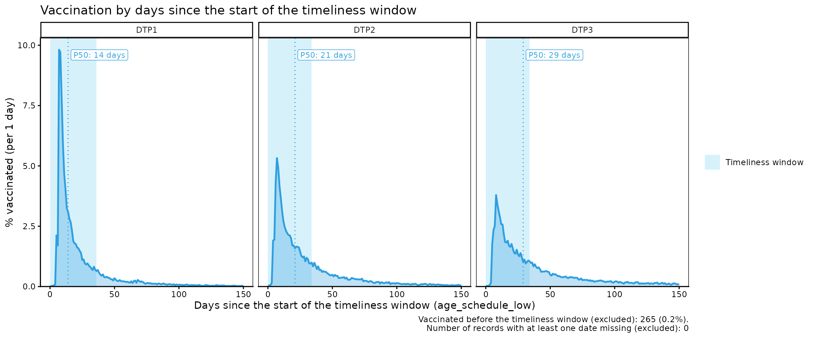

``` r

vt_pdf_plot(data = dist_by_dose_ADM1_df, binwidth = 7, highlight = "ADM1_1", max_days = 200)
```

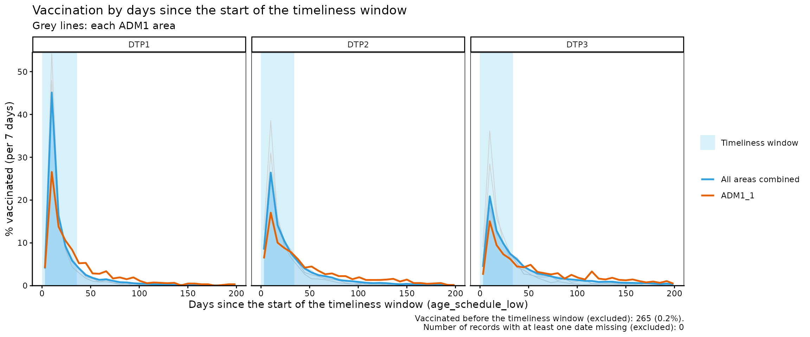

> **Note**
>
> In this last plot with geographic areas, areas with few records can
> show very high daily percentages. That is why the y-axis is limited to
> the highlighted lines, and grey lines that exceed that limit are cut.

##### Parameters accepted by `vt_pdf_plot()`

- `data`: Output of
  [`vt_distribution()`](https://im-data-paho.github.io/pahoabc/reference/vt_distribution.md).
- `percentile`: A single percentile (greater than 0 and at most 100) to
  highlight in the plot. Default: `NULL` (none).
- `highlight`: Character vector with up to 5 geographic areas to
  highlight in color. Only available if the data is disaggregated by
  ADM1 or ADM2. Default: `NULL` (none).
- `within_ADM1`: Character vector to filter specific ADM1 units when
  `geo_level = "ADM2"`. Default: `NULL`.
- `max_days`: Maximum number of days to show on the x-axis. The default
  `NULL` shows up to the day by which 95% of the records have been
  vaccinated, so that a few very late vaccinations (or vaccinations with
  date errors) do not stretch the axis.
- `binwidth`: Number of days represented by each point of the curve (for
  example, 7 to group by week). In the case of geographic areas with few
  records, larger values could lead to smoother curves. Default: 1.

##### Interpretation

Both plots are complementary: in the cumulative incidence curve (`cdf`),
curves that rise quickly indicate vaccination close to the start of the
timeliness window, while curves that rise slowly, or that have an
important stretch to the right of the shaded area, indicate delays. The
same can be seen in the curve of the percentage vaccinated per day
(`pdf`), which directly shows the distribution of vaccinations over
time.

The caption of both plots indicates how many records were excluded for
having been vaccinated before the timeliness window or for having a
missing date. A large number of vaccinations before the window can point
to data entry errors or problems in how the schedule is applied; to
review them, use
[`vt_inconsistent()`](https://im-data-paho.github.io/pahoabc/reference/vt_inconsistent.md)
and
[`vt_inconsistent_plot()`](https://im-data-paho.github.io/pahoabc/reference/vt_inconsistent_plot.md).

> **Warning**
>
> Remember that, when working only with vaccinated individuals, all
> curves end at 100%. This does not mean that the entire target
> population has been vaccinated, but that the analysis was carried out
> only with records of vaccinated individuals.

#### Step 3 — Compute the percentiles with `vt_percentile()`

[`vt_percentile()`](https://im-data-paho.github.io/pahoabc/reference/vt_percentile.md)
takes the output of
[`vt_distribution()`](https://im-data-paho.github.io/pahoabc/reference/vt_distribution.md)
and computes, for each percentile, the number of days needed to reach
it. The results keep the same disaggregation as
[`vt_distribution()`](https://im-data-paho.github.io/pahoabc/reference/vt_distribution.md)
(by dose and/or geographic level):

``` r

vt_percentile(data = dist_df) %>%
  kable(caption = "Days needed to vaccinate 25%, 50% and 75%, all doses combined, 2022 cohort")
```

| percentile | day | within_window | window_end |  total |
|-----------:|----:|:--------------|-----------:|-------:|
|         25 |   8 | NA            |         NA | 216042 |
|         50 |  18 | NA            |         NA | 216042 |
|         75 |  45 | NA            |         NA | 216042 |

Days needed to vaccinate 25%, 50% and 75%, all doses combined, 2022
cohort {.table}

``` r

vt_percentile(data = dist_by_dose_ADM1_df, percentiles = c(50, 80)) %>%
  head(10) %>%
  kable(caption = "Days needed to vaccinate 50% and 80%, by dose and ADM1, 2022 cohort")
```

| dose | ADM1   | percentile | day | within_window | window_end | total |
|:-----|:-------|-----------:|----:|:--------------|-----------:|------:|
| DTP1 | ADM1_1 |         50 |  24 | TRUE          |         36 |  1182 |
| DTP1 | ADM1_1 |         80 |  63 | FALSE         |         36 |  1182 |
| DTP1 | ADM1_2 |         50 |  14 | TRUE          |         36 |  6049 |
| DTP1 | ADM1_2 |         80 |  34 | TRUE          |         36 |  6049 |
| DTP1 | ADM1_3 |         50 |  14 | TRUE          |         36 | 27534 |
| DTP1 | ADM1_3 |         80 |  35 | TRUE          |         36 | 27534 |
| DTP1 | ADM1_4 |         50 |  11 | TRUE          |         36 |  3792 |
| DTP1 | ADM1_4 |         80 |  23 | TRUE          |         36 |  3792 |
| DTP1 | ADM1_5 |         50 |  13 | TRUE          |         36 |  1999 |
| DTP1 | ADM1_5 |         80 |  29 | TRUE          |         36 |  1999 |

Days needed to vaccinate 50% and 80%, by dose and ADM1, 2022 cohort
{.table}

The `within_window` column indicates whether the percentile is reached
within the timeliness window of the dose (it shows `NA` when doses are
combined).

##### Parameters accepted

- `data`: Output of
  [`vt_distribution()`](https://im-data-paho.github.io/pahoabc/reference/vt_distribution.md).
- `percentiles`: Numeric vector with the percentiles to compute.
  Default: `c(25, 50, 75)`.

##### Interpretation

A larger number of days to reach the same percentile indicates later
vaccination. For example, if in one geographic area 50% of the records
are vaccinated within the first 10 days and in another it takes 40 days,
the second one shows delays that warrant investigating possible problems
of access, willingness to vaccinate, or supply.

#### Step 4 — Compare percentiles between geographic areas with `vt_percentile_plot()`

The output of
[`vt_percentile()`](https://im-data-paho.github.io/pahoabc/reference/vt_percentile.md)
can be passed directly to
[`vt_percentile_plot()`](https://im-data-paho.github.io/pahoabc/reference/vt_percentile_plot.md),
which shows one row per geographic area (or per dose, if the data is not
disaggregated geographically). Each percentile is drawn as a point,
joined by a line from the lowest to the highest percentile. Rows are
sorted according to the median (or the closest percentile). Finally,
when the results are disaggregated by dose, the timeliness window of
each one is shaded.

``` r

vt_percentile(data = dist_by_dose_ADM1_df, percentiles = c(25, 50, 75, 90)) %>%
  vt_percentile_plot()
```

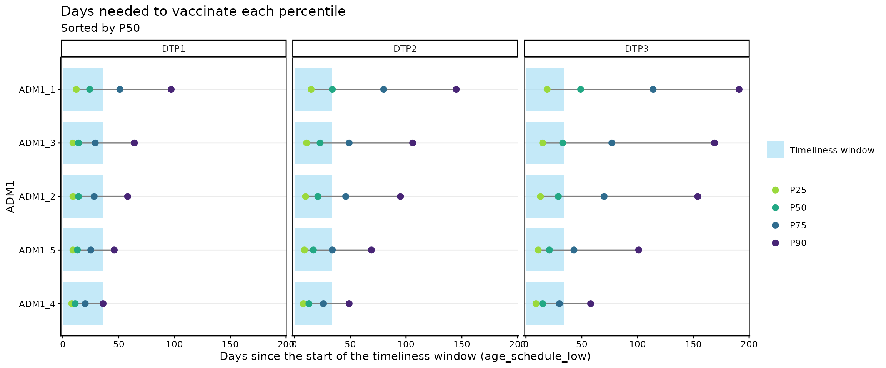

Without geographic disaggregation, one row per dose is shown:

``` r

vt_percentile(data = dist_by_dose_ADM0_df, percentiles = c(25, 50, 75, 90)) %>%
  vt_percentile_plot()
```

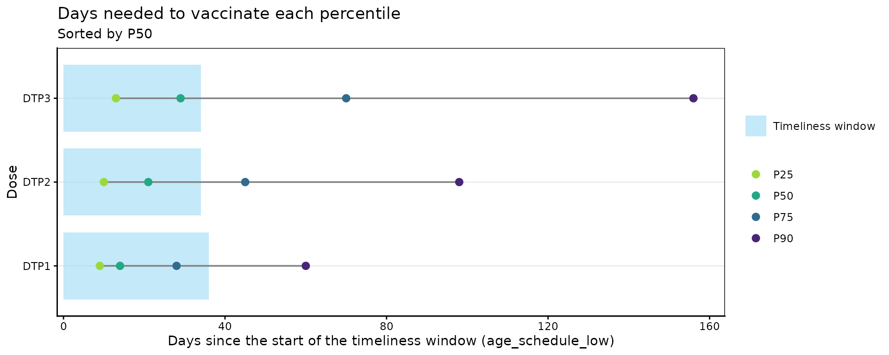

When there are many geographic areas (for example, at the ADM2 level),
the `n_slowest` parameter lets you show only the slowest areas:

``` r

vt_distribution(
  data.EIR      = pahoabc.EIR,
  data.schedule = pahoabc.schedule,
  # at the ADM2 level there are many geographic areas
  geo_level     = "ADM2",
  birth_cohorts = 2022
) %>%
  vt_percentile() %>%
  # show only the 15 slowest
  vt_percentile_plot(n_slowest = 15)
```

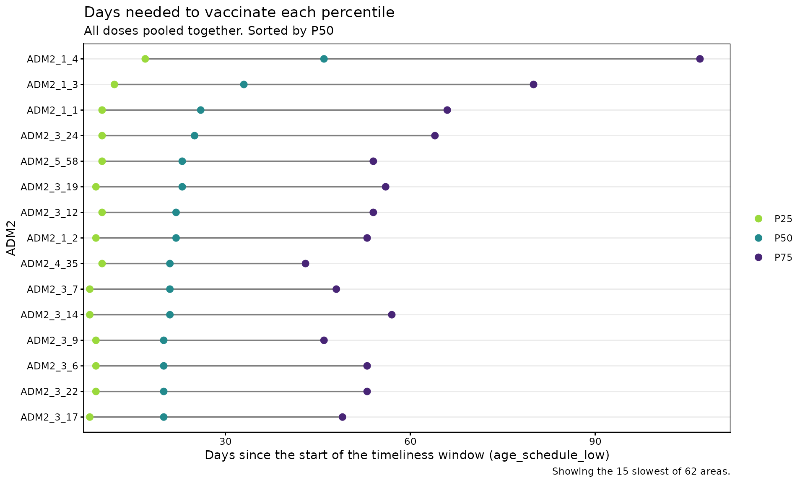

##### Parameters accepted

- `data`: Output of
  [`vt_percentile()`](https://im-data-paho.github.io/pahoabc/reference/vt_percentile.md).
- `within_ADM1`: Character vector to filter specific ADM1 units when
  `geo_level = "ADM2"`. Default: `NULL`.
- `n_slowest`: Number of geographic areas to show, starting with the
  slowest. Default: `NULL` (that is, all).

##### Interpretation

The areas at the top of the plot are the ones that take the longest to
vaccinate half of their records. In plots disaggregated by dose, points
to the right of the shaded area indicate that the percentile is reached
outside the timeliness window, and a long line between the lowest and
the highest percentile indicates that vaccination is very spread out
over time.

> **Warning**
>
> Geographic areas with few records can show extreme percentiles just by
> chance. Before concluding that a certain geographic area is
> vaccinating slowly, check its number of records in the `total` column
> of
> [`vt_percentile()`](https://im-data-paho.github.io/pahoabc/reference/vt_percentile.md).

## Summary

This module allows you to estimate the vaccination timeliness indicator
from EIR data. In the **non-probabilistic** analysis,
[`vt_rate()`](https://im-data-paho.github.io/pahoabc/reference/vt_rate.md)
and
[`vt_barplot()`](https://im-data-paho.github.io/pahoabc/reference/vt_barplot.md)
return the percentage of timely vaccination with different geographic or
dose-level disaggregations;
[`vt_inconsistent()`](https://im-data-paho.github.io/pahoabc/reference/vt_inconsistent.md)
lets you generate a list of the records detected as untimely or missing
vaccination/birth dates; and
[`vt_inconsistent_plot()`](https://im-data-paho.github.io/pahoabc/reference/vt_inconsistent_plot.md)
characterizes the distribution of untimely records by days outside the
timeliness window.

In the **probabilistic analysis**,
[`vt_distribution()`](https://im-data-paho.github.io/pahoabc/reference/vt_distribution.md),
[`vt_cdf_plot()`](https://im-data-paho.github.io/pahoabc/reference/vt_cdf_plot.md)
and
[`vt_pdf_plot()`](https://im-data-paho.github.io/pahoabc/reference/vt_pdf_plot.md)
describe how vaccinations accumulate as days go by since the start of
the timeliness window,
[`vt_percentile()`](https://im-data-paho.github.io/pahoabc/reference/vt_percentile.md)
estimates how many days are needed to vaccinate different percentiles of
the population, and
[`vt_percentile_plot()`](https://im-data-paho.github.io/pahoabc/reference/vt_percentile_plot.md)
lets you visually compare those times between geographic areas.

Together, these tools help immunization programs understand their
coverage, identify communities with access problems or low willingness
to vaccinate, and guide actions to prevent future dropouts.
