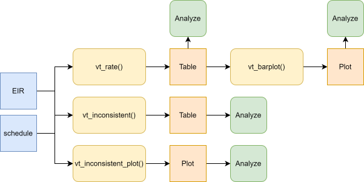
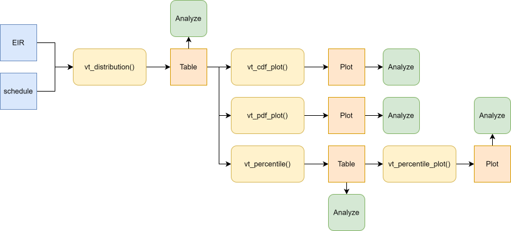

<a href="../en/vaccination_timeliness_en.html" class="btn btn-outline-primary" role="button">🌐 Read this in English</a>

```{r setup, include = FALSE, message = FALSE, warning = FALSE}
library(pahoabc)
library(dplyr)
library(knitr)

opts_chunk$set(warning = FALSE)
```

# Fundamento

El calendario de vacunación de un país se establece considerando las características de cada vacuna, la historia natural de la enfermedad que se busca prevenir, las características de la persona que la va a recibir, el acceso de la población a los vacunatorios y su disposición a vacunarse (o a vacunar a sus hijos).

Con la vacunación se intenta disminuir la mayor cantidad posible de carga de enfermedad, adelantándose al periodo de la vida en que el riesgo de gravedad y muerte por dicha enfermedad es mayor. Al mismo tiempo, el calendario debe considerar la capacidad de la vacuna de generar inmunidad y la duración de esta, condicionada (sobre todo en el primer año de vida) por la madurez del sistema inmunológico. Estos factores determinan, por ejemplo, la necesidad de más de una dosis, los refuerzos a lo largo del curso de vida, la compatibilidad entre vacunas administradas simultáneamente y los tiempos mínimos entre una dosis y otra.

Para obtener el mayor beneficio del calendario establecido por las autoridades sanitarias, el cumplimiento por parte de la población es fundamental, no solo completando el esquema, sino haciéndolo de manera **oportuna**. Conocer la oportunidad de vacunación, es decir, cuán ajustadas al calendario se administran las vacunas, permite:

- entender las coberturas y su impacto en la epidemiología de la enfermedad,
- monitorear la cadena de suministro de vacunas e insumos,
- pesquisar problemas de acceso o de disposición a vacunar en ciertas comunidades y,
- a través de acciones a distintos niveles, prevenir futuros abandonos.

Por tanto, **el objetivo de este indicador** es analizar la oportunidad de vacunación en la población, es decir, el tiempo que transcurre entre la edad de elegibilidad para una determinada dosis de vacuna y la ocurrencia de la vacunación, usando información nominal proveniente de los Registros Nominales de Vacunación electrónicos (RNVe).

> **Nota**
>
> 1. Todas las funciones utilizadas para el análisis de oportunidad de vacunación dentro de PAHOabc comienzan con el prefijo `vt_` (del inglés *vaccination timeliness*).

## Análisis no probabilístico

El análisis no probabilístico mide el tiempo que transcurre entre la edad indicada para una determinada dosis y su administración. Se realiza a partir de la base de datos de vacunados del RNVe, por lo que se mide de manera retrospectiva sobre el total de individuos que recibieron la dosis. Se estima la proporción de individuos que recibe la vacuna de forma oportuna y la que lo hace de forma no oportuna. Luego, se estratifica a quienes no recibieron la vacuna de manera oportuna según el tiempo transcurrido fuera del periodo de oportunidad.

### Definiciones operativas

- **Vacunación oportuna**: aquella que se realiza dentro del rango de tiempo definido por el país como estándar de oportunidad para cada dosis de una vacuna.
- **Porcentaje de vacunación oportuna**: proporción de la población que recibió una dosis dentro de su periodo de oportunidad, sobre el total de la población que recibió esa dosis.
- **Distribución según tiempo transcurrido (demora)**: estratificación de los individuos que no recibieron la dosis oportunamente, distribuidos en categorías de tiempo definidas por el país.

### Definiciones requeridas

Antes de realizar el análisis, el país debe definir:

- **Vacunas a evaluar**: cada dosis de vacuna se analiza individualmente. Posteriormente se puede hacer un análisis agregado de varias dosis.
- **Oportunidad por vacuna**: para cada dosis se define el periodo que se considera oportuno, con una edad mínima y una edad máxima, de acuerdo con las normas del país. En PAHOabc, este periodo corresponde a las columnas `age_schedule_low` y `age_schedule_high` del esquema de vacunación.
- **Categorías de tiempo**: rangos de días para distribuir las vacunaciones no oportunas. El país define los rangos, aunque el paquete incluye rangos predefinidos.
- **Año a evaluar**: queda a discreción del país analizar por cohorte de nacimiento o por año calendario. Las funciones `vt_` permiten filtrar por cohorte de nacimiento con el parámetro `birth_cohorts`.
- **Nivel de desagregación geográfica**: nacional (ADM0), primer nivel subnacional (ADM1) o segundo nivel subnacional (ADM2).
- **Periodo mínimo de observación**: cada individuo incluido en el análisis debe al menos haber completado el periodo de oportunidad de la dosis evaluada.

> **Advertencia**
>
> PAHOabc no verifica el periodo mínimo de observación. Si se incluyen cohortes de nacimiento que aún no completan el periodo de oportunidad a la fecha de extracción de los datos, solo aparecerán en el RNVe quienes ya fueron vacunados, lo que sobreestima la oportunidad. Elija `birth_cohorts` que hayan tenido tiempo suficiente para completar el periodo de oportunidad de las dosis analizadas.

### Características del análisis

- Es un análisis transversal: se mide el número de días entre la fecha de nacimiento y la fecha de administración de la dosis, y se compara con el estándar de oportunidad definido por el país. Si la edad al momento de la vacunación está dentro del periodo de oportunidad, la dosis se clasifica como oportuna; si es anterior o posterior, se clasifica como no oportuna.
- Es independiente del tamaño de la población objetivo: el denominador son todos los individuos que recibieron la dosis evaluada.
- Requiere el calendario de vacunación con la especificación del estándar de oportunidad.
- Usa el lugar de **residencia** para los análisis subnacionales.

### Cálculo del indicador

El indicador de vacunación oportuna se calcula como:

$$
\text{Vacunación oportuna (\%)} = \frac{\text{Dosis de la vacuna X administradas de forma oportuna}}{\text{Total de dosis de la vacuna X administradas en un periodo y lugar determinados}} \times 100
$$

La distribución de las dosis no oportunas por rango de tiempo se calcula como:

$$
\text{Dosis no oportunas en el rango A (\%)} = \frac{\text{Dosis no oportunas en el rango A}}{\text{Total de dosis no oportunas en un periodo y lugar determinados}} \times 100
$$

## Análisis probabilístico

El análisis probabilístico estima la **incidencia acumulada** del evento "administración de una dosis de vacuna", es decir, la probabilidad de que una determinada población reciba la dosis a medida que transcurre el tiempo (desde que se vuelve elegible para recibirla). A partir de esta curva se estima la probabilidad de ser vacunado de forma oportuna y el tiempo necesario para vacunar a distintos percentiles de la población.

> **Nota**
>
> Idealmente, este análisis considera a toda la población que debería recibir la vacuna (por ejemplo, a partir del registro de nacidos vivos). En PAHOabc se trabaja con la base de vacunados del RNVe, es decir, solo con los individuos que recibieron la dosis analizada. En este caso, la probabilidad final siempre será del 100 %, lo que **sobreestima** la probabilidad real de vacunación de la población.

### Definiciones operativas

- **Vacunación oportuna**: al igual que en el análisis no probabilístico, aquella que se realiza dentro del periodo de oportunidad definido por el país para cada dosis. En este análisis, el **día 0** (inicio del periodo de observación) corresponde al límite inferior del periodo de oportunidad (`age_schedule_low`), y no se incluyen las dosis administradas antes de ese día.
- **Probabilidad de ser vacunado al día t**: incidencia acumulada de vacunación al día t. Cuando t corresponde al límite superior del periodo de oportunidad, se obtiene la probabilidad de la población de ser vacunada de manera oportuna.
- **Tiempo necesario para vacunar a un porcentaje de la población**: número de días desde el inicio del periodo de oportunidad que toma vacunar a un determinado percentil de la población (por ejemplo, 25%, 50% y 75%).

### Definiciones requeridas

- **Vacunas a evaluar**: cada dosis se analiza individualmente. PAHOabc también permite combinar varias dosis en una sola curva (alineadas según el día 0 de cada una), pero en ese caso no es posible mostrar un único periodo de oportunidad, ya que cada dosis tiene el suyo.
- **Oportunidad por vacuna**: igual que en el análisis no probabilístico (entre `age_schedule_low` y `age_schedule_high`).
- **Percentiles de la población**: se recomienda estimar al menos los tiempos para 25%, 50% y 75%.
- **Año a evaluar**: se sugiere usar una cohorte de nacimiento. PAHOabc también permite combinar varias cohortes (ver la advertencia a continuación).
- **Nivel de desagregación geográfica**: ADM0, ADM1 o ADM2.

> **Advertencia**
>
> Este análisis sigue la curva de vacunación mucho más allá del periodo de oportunidad, por lo que el periodo de observación necesario es mayor. Si se incluyen cohortes de nacimiento que a la fecha de extracción de los datos no han completado ese periodo de observación, solo aparecerán en el RNVe quienes se vacunaron antes de esa fecha. Quienes se vacunen después aún no aparecen, por lo que la curva puede mostrar una vacunación más rápida de lo que realmente es. Para mitigar esto, elija cohortes de nacimiento que hayan completado el periodo de observación, o excluya las cohortes incompletas.

### Características del análisis

- Es un análisis de incidencia acumulada, que corresponde al complemento de la función de sobrevida de Kaplan-Meier. Kaplan-Meier estima la probabilidad de que un evento **no** suceda en el tiempo; su complemento entrega la probabilidad de que **sí** suceda, en este caso, la vacunación.
- El tiempo se cuenta desde que el individuo es elegible para la dosis (a partir de `age_schedule_low`). Todos los vacunados hasta el límite superior del periodo de oportunidad se consideran oportunos.
- Es independiente del tamaño de la población: el denominador es el total de registros que ingresan al análisis.
- Requiere el calendario de vacunación con la definición del periodo de oportunidad de cada dosis.
- Usa el lugar de **residencia** para los análisis subnacionales.

### Cálculo del indicador

La incidencia acumulada de vacunación al día t es el complemento de la función de sobrevida de Kaplan-Meier:

$$
F(t) = 1 - S(t)
$$

donde $F(t)$ es la probabilidad de haberse vacunado hasta el día t y $S(t)$ es la probabilidad de no haberse vacunado hasta el día t. Como el RNVe solo contiene a individuos vacunados (no hay censura), $F(t)$ es simplemente el porcentaje acumulado de registros vacunados hasta el día t:

$$
F(t) \;(\%) = \frac{\text{Registros vacunados entre el día 0 y el día t}}{\text{Total de registros vacunados desde el día 0}} \times 100
$$

> **Nota**
>
> Los registros vacunados antes del periodo de oportunidad (antes del día 0) y aquellos con alguna fecha faltante se excluyen tanto del numerador como del denominador, y se reportan aparte. Por lo tanto, $F(t)$ evaluada en el último día del periodo de oportunidad **no es igual** al porcentaje `TIMELY` de `vt_rate()`, que sí incluye en su denominador a los vacunados antes del periodo.

# Glosario

## Divisiones político-geográficas

A lo largo de esta viñeta se hace referencia a distintos niveles de división político-geográfica. Estos niveles son definidos por cada país o territorio y pueden recibir nombres diferentes. PAHOabc no depende de esos nombres locales; por eso, el usuario debe recodificar sus variables para ajustarlas a la estructura que utiliza el paquete.

En concreto, PAHOabc puede distinguir tres niveles administrativos que, listados del nivel superior al inferior, son: ADM0, ADM1 y ADM2.

1. ADM0: El país. Este es el nivel administrativo más alto.
2. ADM1: La primera subdivisión geográfica del país. ADM0 contiene varias subdivisiones ADM1.
3. ADM2: La segunda subdivisión geográfica del país. Cada ADM1 contiene varias subdivisiones ADM2.

## Categorías de oportunidad

| Categoría | Significado |
|---|---|
| `TIMELY` | Oportuna: la edad al momento de la vacunación está dentro de `[age_schedule_low, age_schedule_high]`. |
| `UNTIMELY` | No oportuna: la edad al momento de la vacunación está fuera de `[age_schedule_low, age_schedule_high]`, ya sea antes o después del periodo de oportunidad. |
| `DATE_MISSING` | `date_vax` o `date_birth` es `NA`. |

# Uso

## Instalar el paquete

```{r install_package, eval=FALSE}
devtools::install_github("IM-Data-PAHO/pahoabc")
```

## Cargar los datos

Las funciones de este módulo requieren su **RNVe** y un **esquema de vacunación** con los periodos de oportunidad, ambos en el formato estándar de PAHOabc.

### RNVe

El conjunto de datos `pahoabc::pahoabc.EIR` proporciona una tabla nominal simulada con eventos individuales de vacunación de un RNVe. Cada fila corresponde a una vacunación de una persona.

```{r pahoabc-EIR, message=FALSE}
pahoabc.EIR %>% head() %>% kable(caption = "Ejemplo de Registro Nominal de Vacunación electrónico")
```

- `ID`: Número único de identificación de la persona.
- Fecha de nacimiento (`date_birth`): Fecha de nacimiento de la persona.
- Fecha de vacunación (`date_vax`): Fecha del evento de vacunación.
- `ADM1_residence` / `ADM2_residence`: Primer y segundo nivel administrativo geográfico de residencia.
- Dosis (`dose`): Variable combinada que representa el tipo de vacuna y su número de dosis correspondiente (p. ej., DTP1).

> **Advertencia**
>
> 1. Las funciones de este módulo calculan la edad al momento de la vacunación como `date_vax - date_birth`. Si `data.EIR` contiene registros donde `date_vax` ocurre antes que `date_birth` (es decir, una edad de vacunación negativa), esto señala un error de **consistencia de fechas**. Cuando esto ocurre, las funciones `vt_` emiten una advertencia que remite al [módulo de comparación de consistencia de fechas](date_consistency_comparison_es.html) para identificar y resolver esos registros primero.
> 2. Las funciones de este módulo cuentan registros de vacunación, no individuos. Si `data.EIR` contiene registros duplicados (el mismo `ID` y `dose` registrados más de una vez), ese individuo se cuenta más de una vez tanto en el numerador como en el denominador. PAHOabc no elimina duplicados, por lo que usted debe eliminarlos antes de realizar el análisis. Tenga en cuenta que queda a su criterio decidir qué registro conservar para cada `ID` y `dose` (p. ej., el de fecha de vacunación más temprana).

### Esquema de vacunación

El conjunto de datos `pahoabc::pahoabc.schedule` define el esquema nacional de vacunación, indicando para cada dosis la edad de administración y el periodo de oportunidad, en días.

```{r pahoabc-schedule, message=FALSE}
pahoabc.schedule %>% kable(caption = "Ejemplo de esquema de vacunación con periodos de oportunidad")
```

- Dosis (`dose`): Variable combinada que representa el tipo de vacuna y su número de dosis.
- `age_schedule`: La edad de administración de la `dose` correspondiente, en días.
- `age_schedule_low`: La edad mínima del periodo de oportunidad, en días.
- `age_schedule_high`: La edad máxima del periodo de oportunidad, en días.

Por ejemplo, en este esquema la DTP1 está indicada a los 60 días de edad y se considera oportuna si se administra entre los 54 y los 90 días de edad.

## Análisis no probabilístico

### Flujo de trabajo esperado

Las funciones correspondientes al análisis no probabilístico son:

1. `vt_rate()`: calcula el porcentaje de vacunación oportuna, agregado para varias dosis o desagregado por dosis, y por nivel geográfico.
2. `vt_barplot()`: visualiza el resultado de `vt_rate()` como un gráfico de barras apiladas.
3. `vt_inconsistent()`: lista de forma individual los registros no oportunos y con fechas faltantes, indicando además el número de días fuera del periodo de oportunidad.
4. `vt_inconsistent_plot()`: visualiza la distribución de las dosis no oportunas según el número de días fuera del periodo de oportunidad.



<br>

> **Nota**
>
> 1. En los ejemplos a continuación se analiza la cohorte de nacimiento 2022. Los datos de ejemplo incluyen vacunaciones hasta el 31 de diciembre de 2023, por lo que esta cohorte ha completado el periodo de oportunidad de las dosis administradas durante el primer año de edad.
> 2. Al filtrar por `birth_cohorts` se excluyen los registros sin fecha de nacimiento, por lo que en ese caso `DATE_MISSING` solo cuenta los registros sin fecha de vacunación.

### Paso 1 — Calcular el indicador con `vt_rate()`

`vt_rate()` compara la edad al momento de la vacunación con el periodo de oportunidad de cada dosis y devuelve el número (`n`) y el porcentaje (`rate`) de registros clasificados como `TIMELY`, `UNTIMELY` o `DATE_MISSING`, sobre el total de registros (`total`).

Por defecto, `vaccines = NULL` agrega todas las dosis de `data.schedule` en un único indicador. Aquí calculamos el indicador agregado a nivel ADM1:

```{r vt-rate, message=FALSE}
rate_df <- vt_rate(
  data.EIR      = pahoabc.EIR,
  data.schedule = pahoabc.schedule,
  geo_level     = "ADM1",
  birth_cohorts = 2022
)

rate_df %>% kable(digits = 2, caption = "Oportunidad de vacunación agregada por ADM1, cohorte 2022")
```

Al especificar `vaccines`, los resultados se desagregan por dosis (`dose`):

```{r vt-rate-by-dose, message=FALSE}
rate_by_dose_df <- vt_rate(
  data.EIR      = pahoabc.EIR,
  data.schedule = pahoabc.schedule,
  geo_level     = "ADM1",
  vaccines      = c("DTP1", "DTP2", "DTP3"),
  birth_cohorts = 2022
)

rate_by_dose_df %>% head(10) %>% kable(digits = 2, caption = "Oportunidad de vacunación por dosis y ADM1, cohorte 2022")
```

#### Parámetros aceptados

- `data.EIR`: Tabla del RNVe en formato PAHOabc.
- `data.schedule`: Tabla del esquema de vacunación en formato PAHOabc.
- `geo_level`: `"ADM0"` (predeterminado), `"ADM1"` o `"ADM2"`.
- `vaccines`: Vector de caracteres con las dosis a incluir, desagregando los resultados por `dose`. El valor predeterminado `NULL` agrega todas las dosis de `data.schedule`.
- `birth_cohorts`: Vector numérico con la(s) cohorte(s) de nacimiento a incluir. El valor predeterminado `NULL` usa todas las cohortes disponibles.

### Paso 2 — Visualizar el indicador con `vt_barplot()`

El resultado de `vt_rate()` puede pasarse directamente a `vt_barplot()` para producir un gráfico de barras apiladas. Si los datos están desagregados por `dose`, el gráfico se organiza automáticamente en paneles (*facets*) por dosis.

```{r vt-barplot, message=FALSE, fig.width=10, fig.height=5}
vt_barplot(data = rate_df)
```

```{r vt-barplot-facet, message=FALSE, fig.width=10, fig.height=6}
vt_barplot(data = rate_by_dose_df)
```

#### Parámetros aceptados

- `data`: Resultado de `vt_rate()`.
- `within_ADM1`: Vector de caracteres para filtrar unidades ADM1 específicas cuando `geo_level = "ADM2"`. Valor predeterminado: `NULL`.
- `plot_missing`: Booleano. Si es `TRUE` (predeterminado), los registros `DATE_MISSING` se muestran como un segmento separado para que todas las barras sumen 100 %.

#### Interpretación

Cada barra representa una unidad geográfica y se divide en segmentos: `TIMELY` (azul), `UNTIMELY` (naranja) y `DATE_MISSING` (gris). Las barras con una mayor proporción en naranja indican unidades donde una parte importante de las dosis se administra fuera del periodo de oportunidad, lo que amerita investigar posibles problemas de acceso, de disposición a vacunar o de abastecimiento en esas unidades.

> **Nota**
>
> No aparece el segmento gris porque el filtro por la cohorte 2022 excluyó los registros sin fecha de nacimiento, y ningún registro de esta cohorte carece de fecha de vacunación.

### Paso 3 — Inspeccionar los registros no oportunos con `vt_inconsistent()`

`vt_inconsistent()` devuelve una tabla a nivel de registro con todas las dosis `UNTIMELY` y `DATE_MISSING`, incluyendo el número de días fuera del periodo de oportunidad.

> **Nota**
>
> En este ejemplo no filtramos por cohorte de nacimiento porque eso excluiría a aquellos registros sin fecha de nacimiento.

```{r vt-inconsistent, message=FALSE}
inconsistent_df <- vt_inconsistent(
  data.EIR      = pahoabc.EIR,
  data.schedule = pahoabc.schedule,
  vaccines      = "DTP1"
)

inconsistent_df %>%
  # muestra hasta 3 registros UNTIMELY y hasta 3 DATE_MISSING
  group_by(timeliness) %>%
  slice_head(n = 3) %>%
  ungroup() %>%
  kable(caption = "Muestra de registros no oportunos y con fechas faltantes de DTP1")
```

#### Parámetros aceptados

- `data.EIR`: Tabla del RNVe en formato PAHOabc.
- `data.schedule`: Tabla del esquema de vacunación en formato PAHOabc.
- `vaccines`: Vector de caracteres con las dosis a incluir. El valor predeterminado `NULL` incluye todas las dosis de `data.schedule`.
- `birth_cohorts`: Vector numérico con la(s) cohorte(s) de nacimiento a incluir. El valor predeterminado `NULL` usa todas las cohortes disponibles.

La columna `days_outside_range` es negativa cuando la persona fue vacunada antes de `age_schedule_low`, y positiva cuando fue vacunada después de `age_schedule_high` (`NA` cuando falta una fecha). Esta tabla puede exportarse para dar seguimiento a nivel de registro.

### Paso 4 — Visualizar la distribución según tiempo transcurrido con `vt_inconsistent_plot()`

`vt_inconsistent_plot()` produce un gráfico de las dosis no oportunas, agrupadas según el número de días fuera del periodo de oportunidad. Las dosis administradas después del periodo de oportunidad y antes de él se muestran en filas separadas, cada una con su propia escala en el eje vertical.

```{r vt-inconsistent-plot, message=FALSE, fig.width=10, fig.height=6}
vt_inconsistent_plot(
  data.EIR      = pahoabc.EIR,
  data.schedule = pahoabc.schedule,
  vaccines      = "DTP1",
  birth_cohorts = 2022
)
```

Cuando se especifican varias dosis, el gráfico agrega una columna por cada dosis. Dentro de cada fila, todas las dosis comparten la misma escala, por lo que pueden compararse entre sí:

```{r vt-inconsistent-plot-facet, message=FALSE, fig.width=12, fig.height=6}
vt_inconsistent_plot(
  data.EIR      = pahoabc.EIR,
  data.schedule = pahoabc.schedule,
  vaccines      = c("DTP1", "DTP2", "DTP3"),
  birth_cohorts = 2022
)
```

#### Parámetros aceptados

- `data.EIR`: Tabla del RNVe en formato PAHOabc.
- `data.schedule`: Tabla del esquema de vacunación en formato PAHOabc.
- `vaccines`: Vector de caracteres con las dosis a incluir, agregando una columna por cada `dose`. El valor predeterminado `NULL` suma los resultados de todas las dosis en una única columna.
- `birth_cohorts`: Vector numérico con la(s) cohorte(s) de nacimiento a incluir. El valor predeterminado `NULL` usa todas las cohortes disponibles.
- `day_groups`: Define las categorías para el eje horizontal. Es una lista de pares numéricos `c(inferior, superior)` que definen los límites inferior y superior para cada categoría en días. Las categorías deben comenzar en 0 y ser contiguas (cada una comienza donde termina la anterior). La última categoría siempre se extiende hasta el valor máximo de los datos y se etiqueta como `"X+"`. El valor predeterminado es una agrupación de 10 en 10 días desde 0 hasta 90+ días.

Las categorías de tiempo las define cada país. Por ejemplo, para usar las categorías de 0 a 39 días, 40 a 49 días, 50 a 59 días, 60 a 89 días y 90 días o más:

```{r vt-inconsistent-plot-custom, message=FALSE, fig.width=12, fig.height=6}
vt_inconsistent_plot(
  data.EIR      = pahoabc.EIR,
  data.schedule = pahoabc.schedule,
  vaccines      = c("DTP1", "DTP2", "DTP3"),
  birth_cohorts = 2022,
  day_groups    = list(c(0, 40), c(40, 50), c(50, 60), c(60, 90), c(90, 120))
)
```

#### Interpretación

La fila superior representa las dosis administradas después del periodo de oportunidad (demora), mientras que la fila inferior muestra las dosis administradas antes de la edad mínima. Como cada fila tiene su propia escala, compare solamente entre columnas que pertenezcan a una misma fila, y use el resumen en el pie del gráfico para comparar entre filas. La distribución de los datos le permitirá evaluar en dónde se concentran las demoras, por ejemplo: ¿Son demoras de solamente algunos días o la mayoría se concentra en demoras de varios meses? Asimismo, las dosis administradas antes de la edad mínima pueden indicar errores de registro o problemas en la aplicación del calendario.

## Análisis probabilístico

### Flujo de trabajo esperado

Las funciones correspondientes al análisis probabilístico son:

1. `vt_distribution()`: calcula, para cada día desde el inicio del periodo de oportunidad, el porcentaje de registros vacunados ese día y el porcentaje acumulado (incidencia acumulada). Permite desagregar por dosis y nivel geográfico.
2. `vt_cdf_plot()` y `vt_pdf_plot()`: visualizan el resultado de `vt_distribution()` como una curva de incidencia acumulada (similar a una curva de Kaplan-Meier) o como una curva del porcentaje de vacunados por día, respectivamente.
3. `vt_percentile()`: a partir del resultado de `vt_distribution()`, calcula el número de días necesario para vacunar a distintos percentiles de la población.
4. `vt_percentile_plot()`: genera visualizaciones a partir de los resultados de `vt_percentile()`.



<br>

> **Nota**
>
> Al igual que en el análisis no probabilístico, los ejemplos a continuación analizan la cohorte de nacimiento 2022. Como los datos de ejemplo incluyen vacunaciones solo hasta el 31 de diciembre de 2023, las vacunaciones muy tardías de esta cohorte aún no se observan.

### Paso 1 — Calcular la distribución con `vt_distribution()`

`vt_distribution()` calcula la edad al momento de la vacunación y la expresa como días desde el inicio del periodo de oportunidad (donde el día 0 corresponde a `age_schedule_low`). Por defecto, `vaccines = NULL` suma todas las dosis de `data.schedule` en una única distribución:

```{r vt-distribution, message=FALSE}
dist_df <- vt_distribution(
  data.EIR      = pahoabc.EIR,
  data.schedule = pahoabc.schedule,
  birth_cohorts = 2022
)

dist_df %>% head(10) %>% kable(digits = 2, caption = "Distribución de vacunaciones por día, todas las dosis combinadas, cohorte 2022")
```

Al especificar `vaccines`, los resultados se desagregan por dosis, y cada dosis incluye el último día de su periodo de oportunidad en la columna `window_end`:

```{r vt-distribution-by-dose, message=FALSE}
dist_by_dose_ADM1_df <- vt_distribution(
  data.EIR      = pahoabc.EIR,
  data.schedule = pahoabc.schedule,
  geo_level     = "ADM1",
  vaccines      = c("DTP1", "DTP2", "DTP3"),
  birth_cohorts = 2022
)

dist_by_dose_ADM1_df %>% head(10) %>% kable(digits = 2, caption = "Distribución de vacunaciones por día, dosis y ADM1, cohorte 2022")
```

La tabla contiene una fila por cada día (siempre y cuando haya ocurrido al menos una vacunación), con las siguientes columnas:

- `day`: días desde el inicio del periodo de oportunidad (desde `age_schedule_low`).
- `n` y `pdf`: número y porcentaje de registros vacunados ese día.
- `cum_n` y `cdf`: número y porcentaje acumulado de registros vacunados hasta ese día (incidencia acumulada).
- `n_at_risk`: número de registros que aún no se habían vacunado al inicio de ese día (población "en riesgo").
- `total`: denominador, es decir, todos los registros que fueron vacunados desde el día 0.
- `n_early`: registros vacunados antes del periodo de oportunidad, excluidos del análisis.
- `n_missing`: registros con alguna fecha faltante, excluidos del análisis.
- `window_end`: último día del periodo de oportunidad (`age_schedule_high - age_schedule_low`). Es `NA` cuando las dosis están combinadas.

#### Parámetros aceptados

- `data.EIR`: Tabla del RNVe en formato PAHOabc.
- `data.schedule`: Tabla del esquema de vacunación en formato PAHOabc.
- `geo_level`: `"ADM0"` (predeterminado), `"ADM1"` o `"ADM2"`.
- `vaccines`: Vector de caracteres con las dosis a incluir.
- `birth_cohorts`: Vector numérico con la(s) cohorte(s) de nacimiento a incluir. El valor predeterminado `NULL` usa todas las cohortes disponibles.

### Paso 2 — Visualizar la distribución con `vt_cdf_plot()` y `vt_pdf_plot()`

El resultado de `vt_distribution()` puede pasarse directamente a `vt_cdf_plot()`, que grafica la curva de incidencia acumulada. El parámetro `percentile` agrega una línea y una etiqueta con el número de días necesario para alcanzar ese percentil:

```{r vt-distribution-plot, message=FALSE, fig.width=10, fig.height=5}
vt_cdf_plot(data = dist_df, percentile = 50)
```

Si los datos están desagregados por `dose`, el gráfico se organiza en paneles por dosis y se sombrea el periodo de oportunidad de cada una. Si además están desagregados por geografía, cada unidad geográfica se muestra como una línea gris delgada, que sirve de contexto, y el conjunto de todas las unidades se muestra como una única línea destacada. De esta forma, el gráfico sigue siendo legible aun con decenas o cientos de unidades geográficas:

```{r vt-distribution-plot-by-dose, message=FALSE, fig.width=12, fig.height=5}
vt_cdf_plot(data = dist_by_dose_ADM1_df, percentile = 80)
```

Con el parámetro `highlight` puede destacar en color hasta 5 unidades geográficas para compararlas con el conjunto de todas las unidades:

```{r vt-distribution-plot-highlight, message=FALSE, fig.width=12, fig.height=5}
vt_cdf_plot(data = dist_by_dose_ADM1_df, percentile = 80, highlight = c("ADM1_1", "ADM1_4"))
```

#### Parámetros aceptados en `vt_cdf_plot()`

- `data`: Resultado de `vt_distribution()`.
- `percentile`: Un único percentil (mayor que 0 y hasta 100) a destacar en el gráfico, para el conjunto de todas las unidades y para cada unidad en `highlight`. Valor predeterminado: `NULL` (ninguno).
- `highlight`: Vector de caracteres con hasta 5 unidades geográficas (del nivel geográfico de `data`) a destacar en color. Solo disponible si los datos están desagregados por ADM1 o ADM2. Valor predeterminado: `NULL` (ninguna).
- `within_ADM1`: Vector de caracteres para filtrar unidades ADM1 específicas cuando `geo_level = "ADM2"`. Valor predeterminado: `NULL`.
- `max_days`: Número máximo de días a mostrar en el eje horizontal. El valor predeterminado `NULL` muestra hasta el día en que el 95 % de los registros se ha vacunado (en el conjunto de todas las unidades y en cada unidad destacada), para que unas pocas vacunaciones muy tardías (o con errores de fecha) no estiren el eje.

`vt_pdf_plot()` grafica el porcentaje de registros vacunados en cada día (o en un grupo de días, determinado por el parámetro `binwidth`), lo que permite ver en qué momento se concentran las vacunaciones:

```{r vt-distribution-plot-pdf, message=FALSE, fig.width=12, fig.height=5}
dist_by_dose_ADM0_df <- vt_distribution(
  data.EIR      = pahoabc.EIR,
  data.schedule = pahoabc.schedule,
  vaccines      = c("DTP1", "DTP2", "DTP3"),
  birth_cohorts = 2022
)

vt_pdf_plot(data = dist_by_dose_ADM0_df, percentile = 50, max_days = 150)
```

```{r vt-distribution-plot-pdf-geo, message=FALSE, fig.width=12, fig.height=5}
vt_pdf_plot(data = dist_by_dose_ADM1_df, binwidth = 7, highlight = "ADM1_1", max_days = 200)
```

> **Nota**
>
> En este último gráfico con unidades geográficas, las unidades con pocos registros pueden mostrar porcentajes diarios muy altos. Por eso, el eje vertical se limita a las líneas destacadas, y las líneas grises que superan ese límite se cortan.

#### Parámetros aceptados en `vt_pdf_plot()`

- `data`: Resultado de `vt_distribution()`.
- `percentile`: Un único percentil (mayor que 0 y hasta 100) a destacar en el gráfico. Valor predeterminado: `NULL` (ninguno).
- `highlight`: Vector de caracteres con hasta 5 unidades geográficas a destacar en color. Solo disponible si los datos están desagregados por ADM1 o ADM2. Valor predeterminado: `NULL` (ninguna).
- `within_ADM1`: Vector de caracteres para filtrar unidades ADM1 específicas cuando `geo_level = "ADM2"`. Valor predeterminado: `NULL`.
- `max_days`: Número máximo de días a mostrar en el eje horizontal. El valor predeterminado `NULL` muestra hasta el día en que el 95% de los registros se ha vacunado, para que unas pocas vacunaciones muy tardías (o con errores de fecha) no estiren el eje.
- `binwidth`: Número de días que cada punto de la curva representa (por ejemplo, 7 para agrupar por semana). En el caso de unidades geográficas con pocos registros, valores más grandes pueden producir curvas más suaves. Valor predeterminado: 1.

#### Interpretación

Ambos gráficos son complementarios: en la curva de incidencia acumulada (`cdf`), curvas que suben rápidamente indican una vacunación cercana al inicio del periodo de oportunidad, mientras que curvas que suben lentamente, o que tienen un tramo importante a la derecha del área sombreada, indican demoras. Lo mismo se observa en la curva del porcentaje de vacunados por día (`pdf`), que directamente muestra la distribución de las vacunaciones a lo largo del tiempo.

El pie de ambos gráficos indica cuántos registros fueron excluidos por haberse vacunado antes del periodo de oportunidad o por tener alguna fecha faltante. Un número importante de vacunaciones antes del periodo puede indicar errores de registro o problemas en la aplicación del calendario; para revisarlas, use `vt_inconsistent()` y `vt_inconsistent_plot()`.

> **Advertencia**
>
> Recuerde que, al trabajar solo con vacunados, todas las curvas terminan en 100%. Esto no significa que toda la población objetivo se haya vacunado, sino que el análisis se realizó solamente con registros de personas vacunadas.

### Paso 3 — Calcular los percentiles con `vt_percentile()`

`vt_percentile()` recibe el resultado de `vt_distribution()` y calcula, para cada percentil, la cantidad de días necesarios para alcanzarlo. Los resultados mantienen la misma desagregación que `vt_distribution()` (por dosis y/o nivel geográfico):

```{r vt-percentile, message=FALSE}
vt_percentile(data = dist_df) %>%
  kable(caption = "Días necesarios para vacunar al 25 %, 50 % y 75 %, todas las dosis combinadas, cohorte 2022")
```

```{r vt-percentile-by-dose, message=FALSE}
vt_percentile(data = dist_by_dose_ADM1_df, percentiles = c(50, 80)) %>%
  head(10) %>%
  kable(caption = "Días necesarios para vacunar al 50 % y 80 %, por dosis y ADM1, cohorte 2022")
```

La columna `within_window` indica si el percentil se alcanza dentro del periodo de oportunidad de la dosis (muestra `NA` cuando las dosis están combinadas).

#### Parámetros aceptados

- `data`: Resultado de `vt_distribution()`.
- `percentiles`: Vector numérico con los percentiles a calcular. Valor predeterminado: `c(25, 50, 75)`.

#### Interpretación

Un mayor número de días para alcanzar un mismo percentil indica una vacunación más tardía. Por ejemplo, si en una unidad geográfica el 50% de los registros se vacuna en los primeros 10 días y en otra se requieren 40 días, la segunda presenta demoras que ameritan investigar posibles problemas de acceso, de disposición a vacunar o de abastecimiento.

### Paso 4 — Comparar los percentiles entre unidades geográficas con `vt_percentile_plot()`

El resultado de `vt_percentile()` puede pasarse directamente a `vt_percentile_plot()`, que muestra una fila por unidad geográfica (o por dosis, si los datos no están desagregados geográficamente). Cada percentil se dibuja como un punto, unidos por una línea desde el percentil más bajo hasta el más alto. Las filas se ordenan de acuerdo a la mediana (o el percentil más cercano). Por último, cuando los resultados se desagregan por dosis, se sombrea el periodo de oportunidad de cada una.

```{r vt-percentile-plot, message=FALSE, fig.width=12, fig.height=5}
vt_percentile(data = dist_by_dose_ADM1_df, percentiles = c(25, 50, 75, 90)) %>%
  vt_percentile_plot()
```

Sin desagregación geográfica, se muestra una fila por dosis:

```{r vt-percentile-plot-dose, message=FALSE, fig.width=10, fig.height=4}
vt_percentile(data = dist_by_dose_ADM0_df, percentiles = c(25, 50, 75, 90)) %>%
  vt_percentile_plot()
```

Cuando hay muchas unidades geográficas (por ejemplo, a nivel ADM2), el parámetro `n_slowest` permite mostrar solo las unidades más tardías:

```{r vt-percentile-plot-adm2, message=FALSE, fig.width=10, fig.height=6}
vt_distribution(
  data.EIR      = pahoabc.EIR,
  data.schedule = pahoabc.schedule,
  # a nivel ADM2 hay muchas unidades geográficas
  geo_level     = "ADM2",
  birth_cohorts = 2022
) %>%
  vt_percentile() %>%
  # mostramos solo las 15 con avance más lento
  vt_percentile_plot(n_slowest = 15)
```

#### Parámetros aceptados

- `data`: Resultado de `vt_percentile()`.
- `within_ADM1`: Vector de caracteres para filtrar unidades ADM1 específicas cuando `geo_level = "ADM2"`. Valor predeterminado: `NULL`.
- `n_slowest`: Número de unidades geográficas a mostrar, empezando por las más tardías. Valor predeterminado: `NULL` (es decir, todas).

#### Interpretación

Las unidades en la parte superior del gráfico son las que más tardan en vacunar a la mitad de sus registros. En las gráficas desagregadas por dosis, los puntos a la derecha del área sombreada indican que ese percentil se alcanza fuera del periodo de oportunidad, y una línea larga entre el percentil más bajo y el más alto indica que la vacunación está muy dispersa en el tiempo.

> **Advertencia**
>
> Las unidades geográficas con pocos registros pueden mostrar percentiles extremos solo por azar. Antes de concluir que cierta unidad geográfica está vacunando lentamente, revise su número de registros en la columna `total` de `vt_percentile()`.

# Resumen

Este módulo le permite estimar el indicador de oportunidad de vacunación a partir de los datos del RNVe. En el análisis **no probabilístico**, `vt_rate()` y `vt_barplot()` devuelven el porcentaje de vacunación oportuna con distintas desagregaciones geográficas o por dosis; `vt_inconsistent()` le permite generar un listado de los registros detectados como no oportunos o sin fechas de vacunación/nacimiento; y `vt_inconsistent_plot()` caracteriza la distribución de registros no oportunos de acuerdo a días fuera del periodo de oportunidad.

En el **análisis probabilístico**, `vt_distribution()`, `vt_cdf_plot()` y `vt_pdf_plot()` describen cómo se acumulan las vacunaciones a medida que transcurren los días desde el inicio del periodo de oportunidad, `vt_percentile()` estima cuántos días se necesitan para vacunar a distintos percentiles de la población, y `vt_percentile_plot()` permite comparar esos tiempos de manera visual entre unidades geográficas.

En conjunto, estas herramientas ayudan a los programas de inmunización a entender sus coberturas, identificar comunidades con problemas de acceso o de disposición a vacunar y orientar acciones para prevenir futuros abandonos.
